# AA Bridge

  <a href="#ru"><strong>🇷🇺 Читать на русском</strong></a> &nbsp;|&nbsp;
  <a href="#en"><strong>🇬🇧 Read in English</strong></a> &nbsp;|&nbsp;
  <a href="https://flatisqa.github.io/aa-bridge/"><strong>📖 Сайт с инструкцией / Guide website (auto RU/EN)</strong></a> &nbsp;|&nbsp;
  <a href="../../releases/latest"><strong>📦 Скачать APK / Download APK</strong></a>

---

## 🇷🇺 Русский

### Что это такое

**AA Bridge** — приложение для Android, которое позволяет запускать на экране Android Auto (в машине) приложения, которые туда официально не попадают: плееры, браузеры, VPN-клиенты и прочее.

Есть два способа это использовать:

1. **Сам AA Bridge как список приложений.** Иконка AA Bridge появляется на экране машины. Открыв её, вы видите список всех приложений, установленных на телефоне, и можете запустить любое прямо там — на весь экран.
2. **Отдельные «обёртки» (wrapper).** Для конкретного приложения (например, VLC или AdGuard VPN) можно создать отдельную маленькую APK со своей иконкой. Она появляется на главном экране машины рядом с Картами и Музыкой и открывает это приложение сразу, без списка.

Разница наглядно: открыв иконку **AA Bridge**, вы видите список из всех приложений телефона с поиском и вкладками «Избранные / Недавние / Все». Открыв иконку **обёртки** (например AdGuard VPN), вы попадаете сразу в само приложение — как будто оно установлено в машину нативно.

Обёртка — это просто быстрый способ попасть к конкретному приложению в один тап, не выбирая его каждый раз из общего списка.

### ⚠️ Важно про предупреждение Google Play Защиты

При установке и при любом последующем обновлении AA Bridge **Google Play Защита покажет предупреждение** («Рекомендуется проверка приложения» / «AA Bridge может быть опасен»). Это ожидаемо для приложения вне Google Play — оно просит у Android права, которых нет у обычных приложений (своя установка пакетов, доступ к отладке по Wi-Fi, виртуальные дисплеи).

**Что нажимать:**
- Нажмите **«Подробнее»**, затем появится ссылка **«Установить без проверки»** — нажмите её.
- **Никогда не нажимайте «Проверить».** Эта кнопка отправляет APK в Google на анализ. На практике после такой проверки Google иногда помечает конкретную версию пакета как вредоносную по серверному вердикту, и дальнейшая установка той же версии блокируется жёстко, без возможности обойти предупреждение. Один раз нажатая «Проверка» — и переустановить этот же файл стандартным способом может быть уже нельзя.

Это правило касается *каждого* такого предупреждения — и при первой установке, и при обновлении, и при установке каждой новой обёртки.

### Установка — шаг за шагом

1. **Скачайте APK** по ссылке выше и откройте файл в Загрузках.
2. Появится предупреждение Play Защиты (см. выше) — «Подробнее» → «Установить без проверки».

   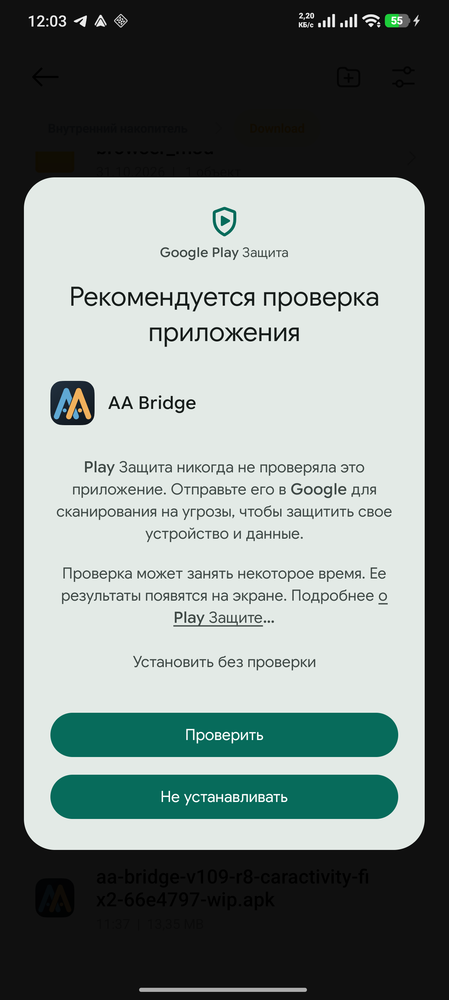

3. Если Android попросит разрешить установку из этого источника — разрешите (переключатель в системных настройках).

   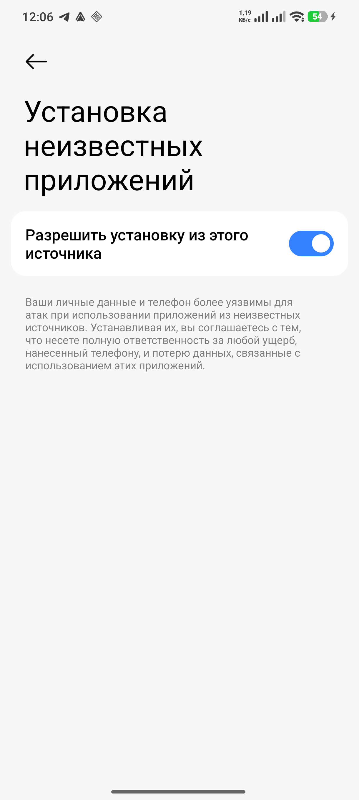

4. Откроется экран онбординга AA Bridge с чеклистом условий.

   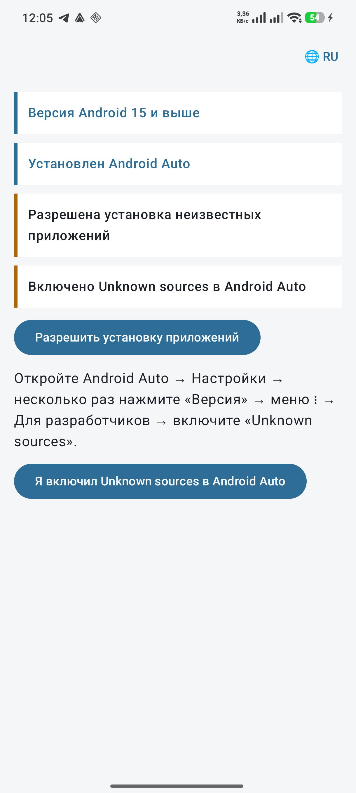

5. Останется пункт **«Unknown sources» в самом Android Auto** — его нужно включить отдельно: в приложении Android Auto на телефоне откройте Настройки → несколько раз нажмите на номер версии внизу, откроется меню «Для разработчиков» → включите переключатель «Неизвестные источники».

   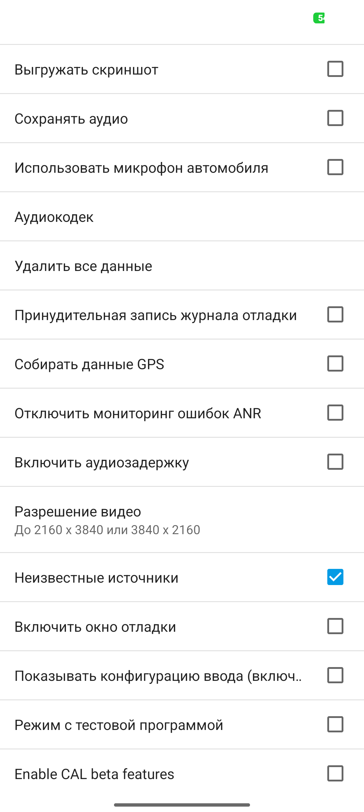

6. Вернитесь в AA Bridge и нажмите «Я включил Unknown sources в Android Auto».

   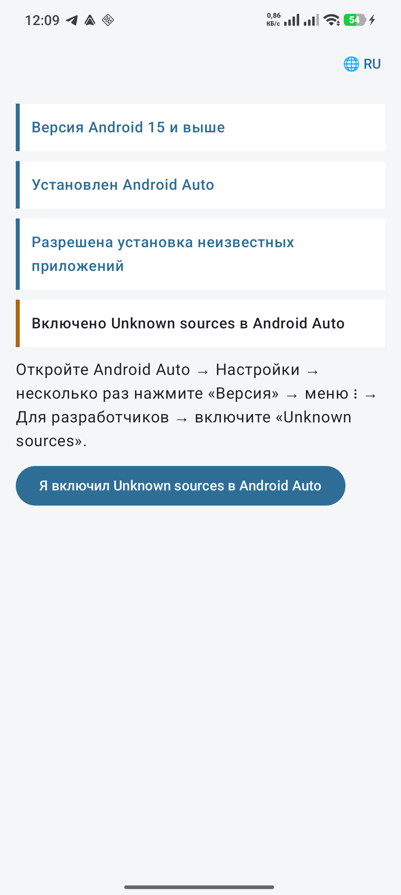

7. Разрешите уведомления — через них придёт код сопряжения.

   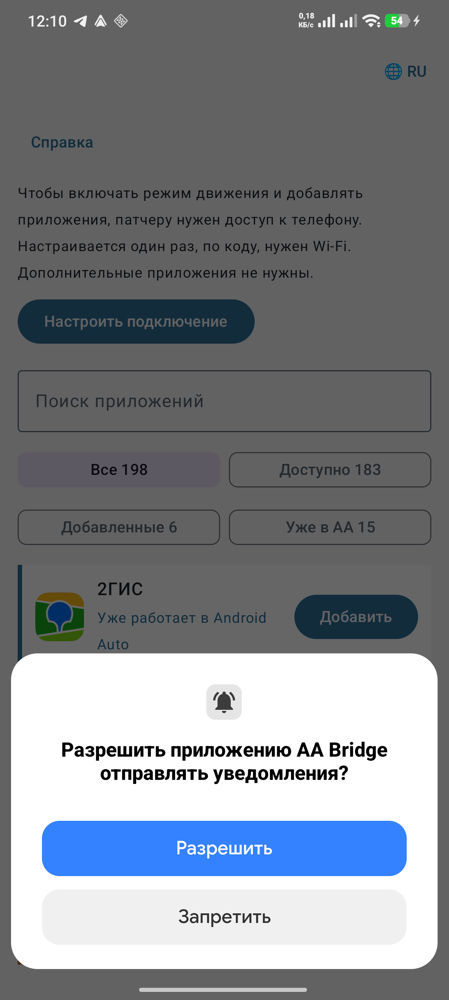

### Сопряжение с телефоном (один раз)

Приложению нужен доступ к собственной «Беспроводной отладке» телефона — это одноразовая настройка, похожая на подключение нового Bluetooth-устройства. Нужен Wi-Fi (любая сеть, не обязательно домашняя).

8. Появится диалог с инструкцией по сопряжению.

   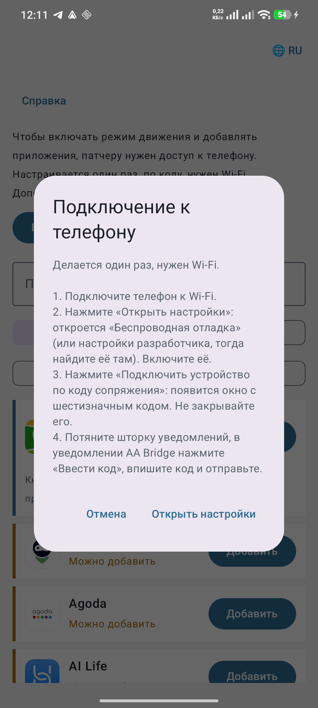

9. Нажмите «Открыть настройки» → откроется системный экран «Беспроводная отладка» → нажмите «Подключить устройство с помощью кода подключения».

   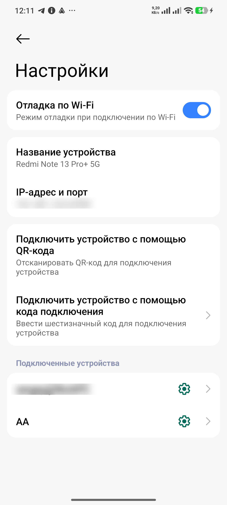

10. На экране появится 6-значный код.

    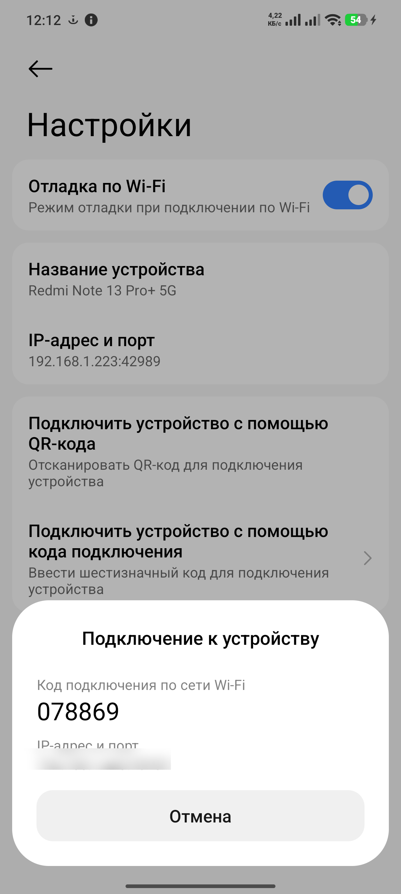

11. Откройте шторку уведомлений, найдите уведомление **«AA Bridge: сопряжение»**, введите туда код из п.10 и нажмите стрелку отправки.

    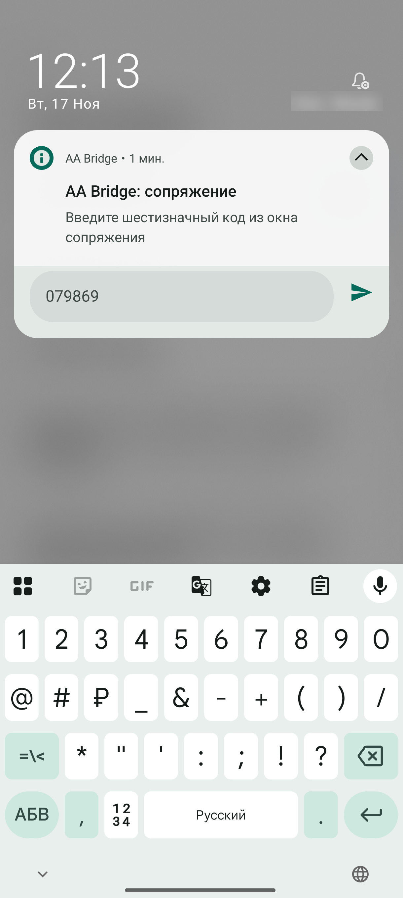

12. Если всё верно — появится системный диалог **«Обновить приложение?»**. Нажмите **«Обновить»**.

    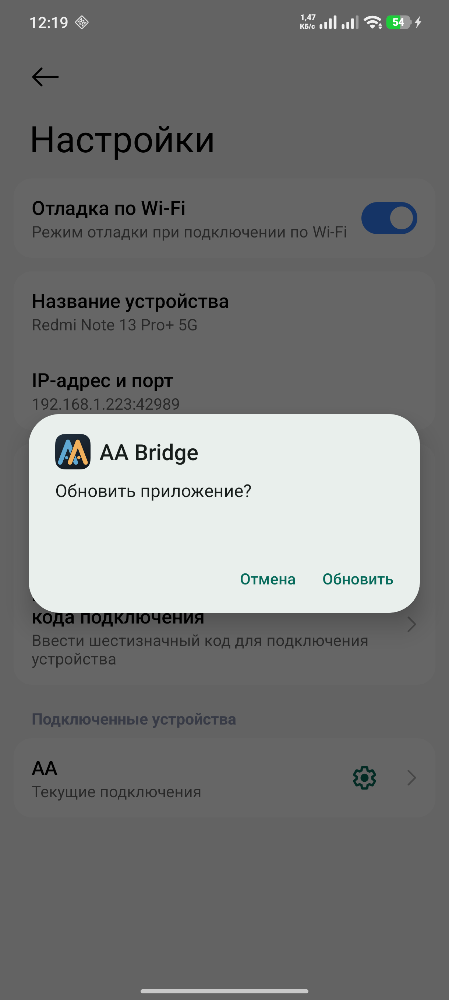

13. Снова появится предупреждение Play Защиты — опять «Подробнее» → «Установить без проверки» (см. предупреждение выше, **не «Проверить»**).

    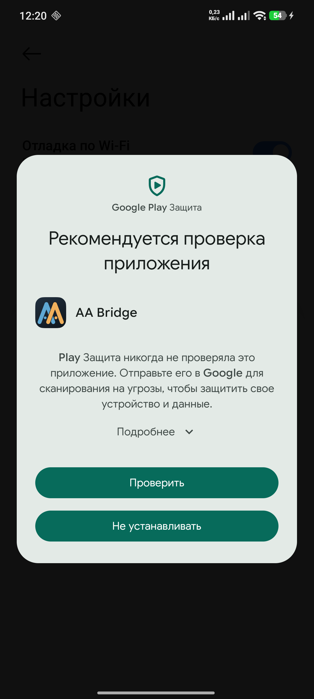

14. Готово — AA Bridge покажет, что запись об установке исправлена, и теперь Android Auto будет видеть приложение правильно.

    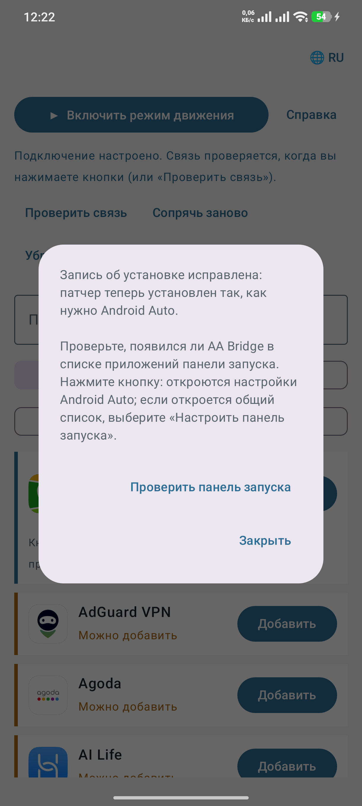

Зачем нужен этот шаг: Android Auto показывает в машине только приложения, которые были установлены через Google Play. Шаги 12–14 — это самообновление AA Bridge через системный установщик с пометкой «из Google Play», без чего приложение не появилось бы в автомобиле вообще.

### Главный экран

После сопряжения откроется главный экран со списком всех приложений телефона.

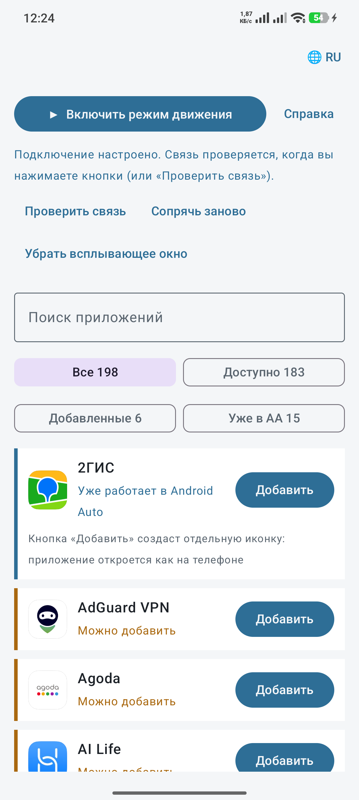

- Поиск и вкладки «Все / Доступно / Добавленные / Уже в AA» — чтобы быстро найти нужное приложение.
- У каждого приложения кнопка **«Добавить»** — создаёт отдельную иконку-обёртку (см. ниже).
- Приложения, у которых Android Auto и так официально поддерживается (например 2ГИС), помечены «Уже работает в Android Auto» — обёртка им не нужна.

### Добавление обёртки для конкретного приложения

15. Нажмите «Добавить» у нужного приложения — появится объяснение разницы между запуском через общий список и отдельной иконкой.

    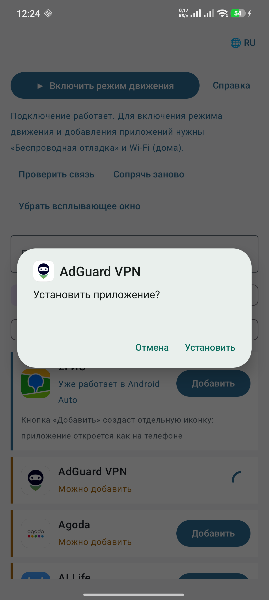

16. Снова будет предупреждение Play Защиты — так же «Подробнее» → «Установить без проверки» (**не «Проверить»**).

    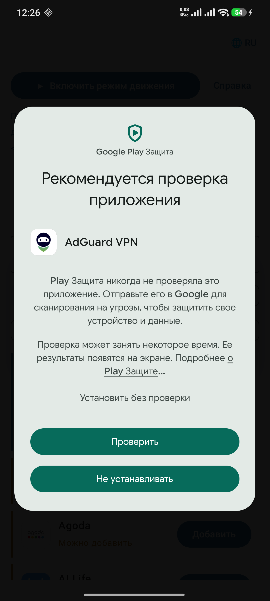

17. Готово — иконка добавлена.

    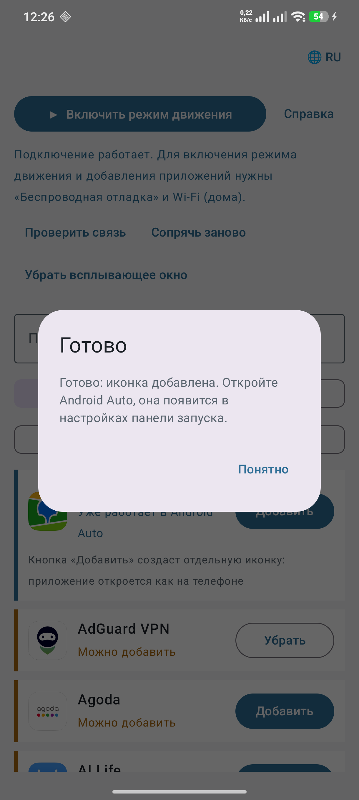

### Включение режима движения

Чтобы приложение работало в машине без постоянного Wi-Fi, один раз включите «режим движения» дома.

18. Нажмите «Включить режим движения» на главном экране и подтвердите.

    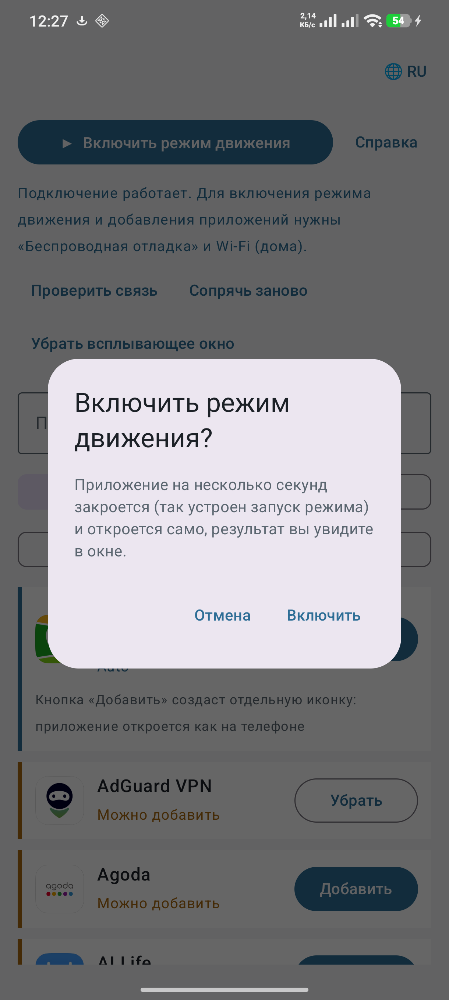

19. Готово: Wi-Fi больше не нужен, можно ехать в машину.

    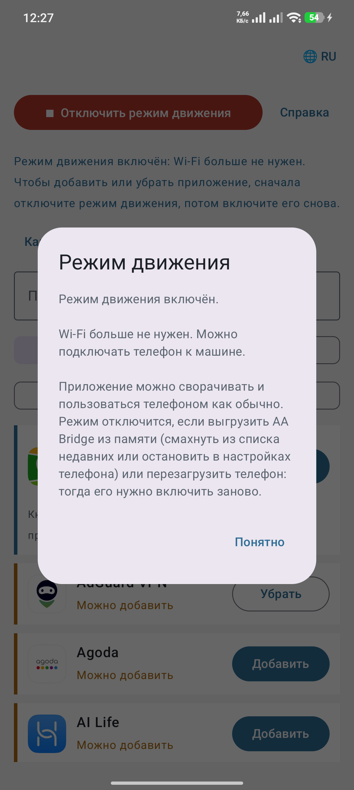

> ⚠️ Режим движения живёт, пока жив процесс приложения. Если его смахнуть из недавних приложений или перезагрузить телефон/машину — режим придётся включить заново (Wi-Fi дома снова понадобится на минуту).

### Использование в машине

Подключите телефон к Android Auto как обычно (кабель или беспроводно).

- **Иконка AA Bridge** на экране машины открывает список всех приложений телефона — как на шаге с главным экраном, но уже в машине.

  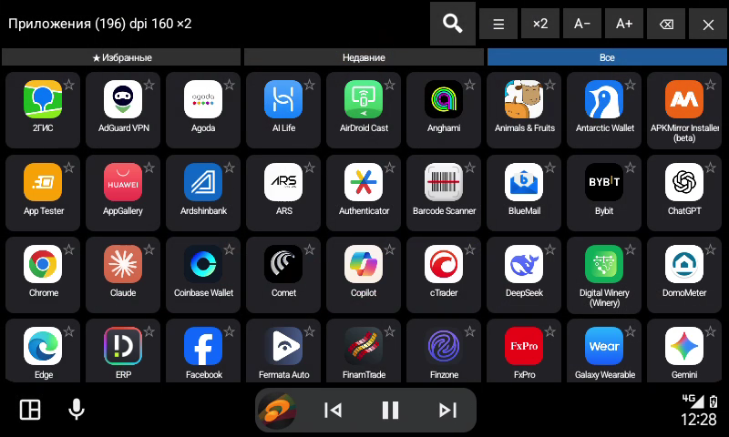

- **Иконка обёртки** (например AdGuard VPN) открывает это приложение сразу, без списка — выглядит как обычное приложение для авто.

  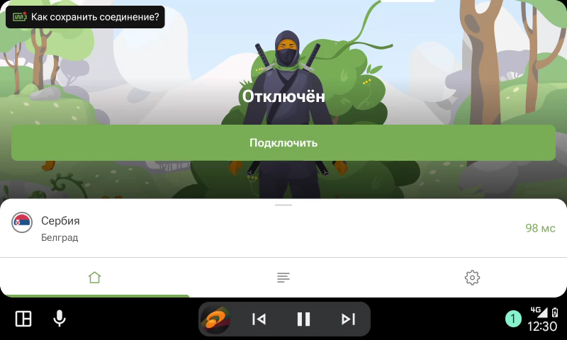

- Обе иконки видны рядом с обычными приложениями на главном экране машины:

  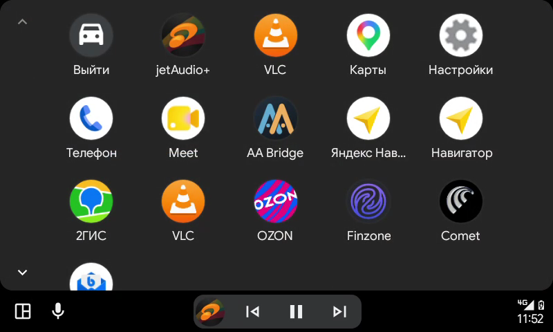

### Выход из приложения в машине

Специальных кнопок на экране нет, чтобы не занимать место. Три быстрых тапа по самой верхней полоске экрана открывают скрытое меню с кнопками «Назад» и «Закрыть».

### Безопасность

Начиная с этой версии APK собирается с R8 (сокращение и обфускация кода): имена большинства внутренних классов и методов заменены на случайные, добавлена защита шаблона обёртки. Полностью скрыть манифест (список разрешений и системных компонентов) невозможно — так устроен Android, — но прочитать логику приложения стало заметно сложнее.

### Лицензия

MIT — см. [LICENSE](LICENSE).

---

## 🇬🇧 English

### What is this

**AA Bridge** is an Android app that lets you run apps on the Android Auto screen (in your car) that are not officially supported there: media players, browsers, VPN clients, and so on.

There are two ways to use it:

1. **AA Bridge itself as an app list.** The AA Bridge icon appears on the car screen. Opening it shows a list of every app installed on your phone, and you can launch any of them full-screen right there.
2. **Individual "wrappers".** For a specific app (e.g. VLC or AdGuard VPN) you can generate a tiny separate APK with its own icon. It appears on the car's home screen next to Maps and Music, and opens that one app directly, with no list in between.

The difference, visually: opening the **AA Bridge** icon shows a searchable list of every phone app with "Favourites / Recent / All" tabs. Opening a **wrapper** icon (e.g. AdGuard VPN) drops you straight into that app — as if it were natively installed in the car.

A wrapper is just a one-tap shortcut to a specific app, so you don't have to pick it from the full list every time.

### ⚠️ About the Google Play Protect warning

When you install AA Bridge, and again on every later update, **Google Play Protect will show a warning** ("App scan recommended" / "AA Bridge may be harmful"). This is expected for an app distributed outside Google Play — it requests permissions ordinary apps don't have (installing packages itself, wireless debugging access, virtual displays).

**What to tap:**
- Tap **"Details"**, a link **"Install without scanning"** will appear — tap that.
- **Never tap "Check".** That button uploads the APK to Google for analysis. In practice, after such a check Google can mark that specific package version as harmful by a server-side verdict, and installing that exact version is then blocked outright, with no way to dismiss the warning. Once "Check" is pressed, reinstalling that same file the normal way may no longer be possible.

This rule applies to *every* such warning — on first install, on updates, and when installing each new wrapper.

### Installation — step by step

1. **Download the APK** from the link above and open it from your Downloads.
2. A Play Protect warning appears (see above) — "Details" → "Install without scanning".

   

3. If Android asks to allow installs from this source, allow it (a toggle in system settings).

   

4. The AA Bridge onboarding screen opens with a checklist of requirements.

   

5. One item remains: **"Unknown sources" inside Android Auto itself** — enable it separately: open the Android Auto app on your phone, go to Settings, tap the version number near the bottom several times to unlock "Developer settings", then enable the "Unknown sources" toggle there.

   

6. Go back to AA Bridge and tap "I enabled Unknown sources in Android Auto".

   

7. Allow notifications — the pairing code arrives through one.

   

### Pairing with your phone (one-time)

The app needs access to the phone's own "Wireless debugging" — a one-time setup similar to pairing a new Bluetooth device. You need Wi-Fi (any network, not necessarily your home one).

8. A dialog with pairing instructions appears.

   

9. Tap "Open settings" → the system "Wireless debugging" screen opens → tap "Pair device with pairing code".

   

10. A 6-digit code appears on screen.

    

11. Open the notification shade, find the **"AA Bridge: pairing"** notification, type the code from step 10 into its field and tap the send arrow.

    

12. If correct, a system **"Update app?"** dialog appears. Tap **"Update"**.

    

13. Another Play Protect warning appears — again "Details" → "Install without scanning" (see the warning above, **not "Check"**).

    

14. Done — AA Bridge confirms the install record is fixed, and Android Auto will now recognize the app correctly.

    

Why this step exists: Android Auto only shows apps in the car that were installed through Google Play. Steps 12–14 make AA Bridge update itself through the system installer tagged as "from Google Play" — without this, the app would never appear in the car at all.

### Main screen

After pairing, the main screen opens with a list of every app on your phone.

- Search and the "All / Available / Added / Already in AA" tabs help you find an app quickly.
- Every app has an **"Add"** button that creates a separate wrapper icon (see below).
- Apps that Android Auto already supports natively (e.g. 2GIS) are marked "Already works in Android Auto" — they don't need a wrapper.

### Adding a wrapper for a specific app

15. Tap "Add" next to the app you want — an explanation of the difference between the shared list and a dedicated icon appears.

    

16. Another Play Protect warning appears — again "Details" → "Install without scanning" (**not "Check"**).

    

17. Done — the icon has been added.

    

### Enabling drive mode

So the app keeps working in the car without a constant Wi-Fi connection, enable "drive mode" once at home.

18. Tap "Enable drive mode" on the main screen and confirm.

    

19. Done: Wi-Fi is no longer needed, you can head to the car.

    

> ⚠️ Drive mode stays on only as long as the app's process is alive. Swiping it away from Recents, or rebooting the phone/car, turns it off — you'll need to re-enable it (Wi-Fi at home, briefly, again).

### Using it in the car

Connect your phone to Android Auto as usual (cable or wireless).

- The **AA Bridge icon** on the car screen opens the same app list as on the phone's main screen, now in the car.

  

- A **wrapper icon** (e.g. AdGuard VPN) opens that app directly, with no list — it looks like a regular car app.

  

- Both kinds of icons sit right next to regular apps on the car's home screen:

  

### Exiting the app in the car

There are no on-screen buttons, to avoid wasting space. Three quick taps on the very top strip of the screen open a hidden menu with "Back" and "Close" buttons.

### Security

Starting with this build, the APK is built with R8 (code shrinking and obfuscation): most internal class and method names are replaced with random ones, and the wrapper template is protected too. The manifest (permission list and system component names) can't be fully hidden — that's how Android works — but reading the app's internal logic is now considerably harder.

### License

MIT — see [LICENSE](LICENSE).
