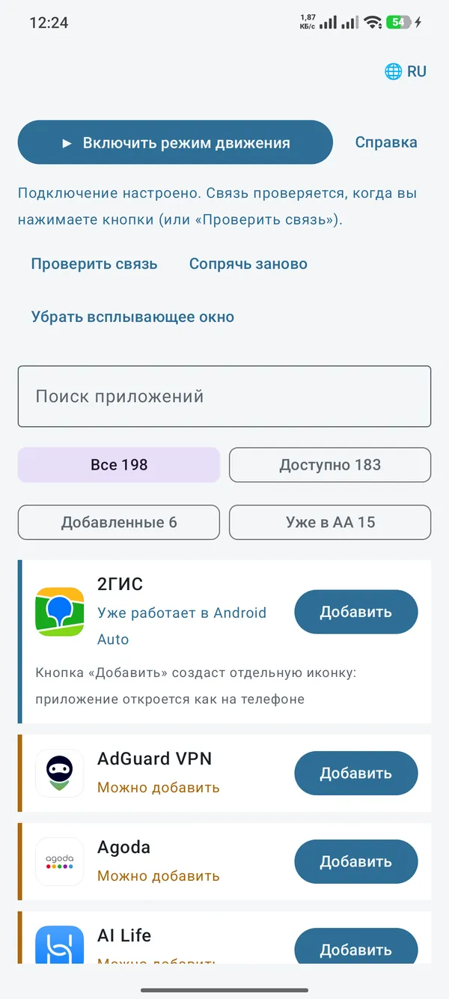
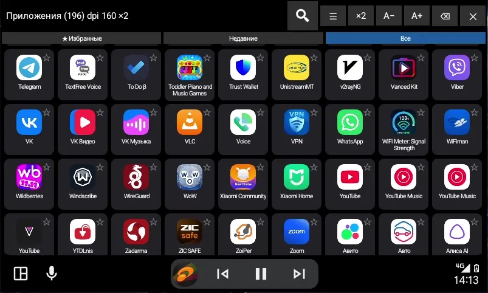
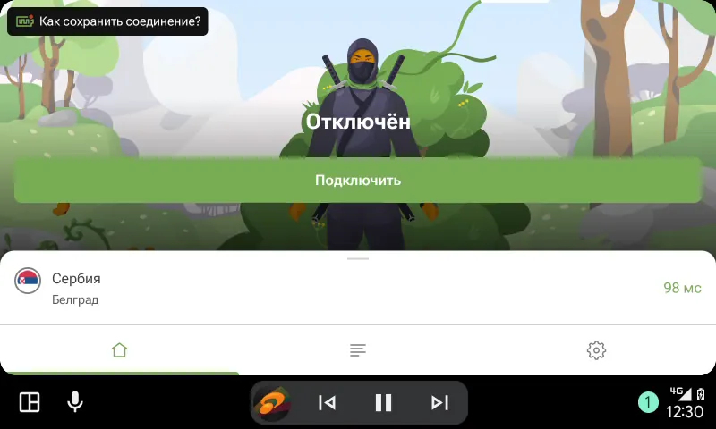

# AA Bridge

[English](README.md) · [Русский](README.ru.md) · [Step-by-step guide](https://flatisqa.github.io/aa-bridge/) · [Download](https://github.com/flatisqa/aa-bridge/releases/latest) · [Ask a question](https://t.me/aabridge/7)

An Android app that shows apps on the Android Auto screen that Android Auto does not list on its own: media players, browsers, VPN clients and so on.

<table>
  <tr>
    <td></td>
    <td></td>
    <td></td>
  </tr>
  <tr>
    <td align="center">Phone</td>
    <td align="center">Car: app list</td>
    <td align="center">Car: wrapper</td>
  </tr>
</table>

## How it works

AA Bridge appears in the Android Auto launcher as a regular app. Selected apps are started on a virtual display that is streamed to the car screen, and touches from the car are forwarded back to them.

There are two ways to open an app:

- **AA Bridge icon.** Opens a searchable list of all apps on the phone (Favourites / Recent / All). Pick one and it opens full screen.
- **Wrapper.** A small separate APK generated on the phone for one app, with its own icon in the car launcher. It opens that app directly.

A wrapper is optional. Any app on the phone can be launched straight from the AA Bridge list in the car, without installing anything extra.

To install a wrapper for an app, drive mode has to be turned off. If you need to launch an app without turning drive mode off (for example on the road or without Wi-Fi), use the AA Bridge app list in the car: all phone apps are available there at once.

## Requirements

- Android 10 or newer (`minSdk 29`). Tested on one phone only: Android 16, HyperOS.
- Android Auto with *Unknown sources* enabled in its developer settings.
- Wi-Fi for the one-time setup (any network).

## Install

1. Download the APK from [Releases](https://github.com/flatisqa/aa-bridge/releases/latest) and open it.
2. Google Play Protect will warn about the app. Tap **Details**, then **Install without scanning**. Do not tap **Check** (see below).
3. Follow the onboarding screen: enable *Unknown sources* in Android Auto, allow notifications.
4. Pair the app with the phone's own *Wireless debugging* once, using the code from the notification.
5. Optional: enable *drive mode* so the app works in the car without Wi-Fi.

The full walkthrough with a screenshot for every step is in the [guide](https://flatisqa.github.io/aa-bridge/).

## Things to know

**Play Protect.** The app is not distributed through Google Play and asks for unusual capabilities (installing packages, wireless debugging, virtual displays), so Play Protect warns on every install and update, including each new wrapper. Always choose *Install without scanning*. *Check* uploads the APK to Google, and a negative verdict can block installation of that package, so we advise against it.

**Drive mode** lasts as long as the app process is alive. Swiping the app out of Recents or rebooting the phone turns it off, and you need to enable it again with Wi-Fi.

**Leaving an app started from the AA Bridge list.** Tap the top edge of the car screen three times quickly. A menu with *Back* and *Close* opens; there are no on-screen buttons. This applies only to apps launched from the list. A wrapper runs as a standalone app and does not have this menu.

**Driving restrictions.** AA Bridge does not remove Android Auto's restrictions while the car is moving. Using it while driving is your responsibility and may be illegal where you live.

The app is not affiliated with Google. The source code is not published.

## Ask a question

Questions and installation problems: [Telegram](https://t.me/aabridge/7).

## License

[MIT](LICENSE)
