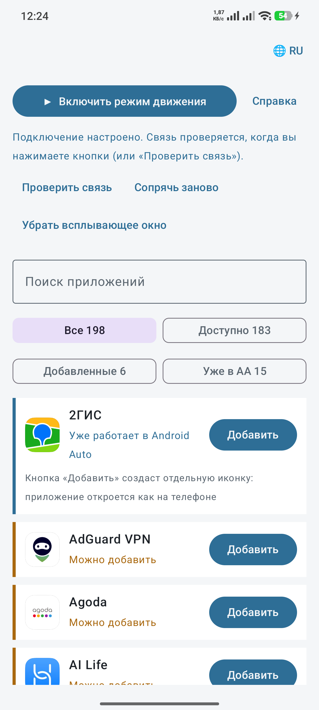
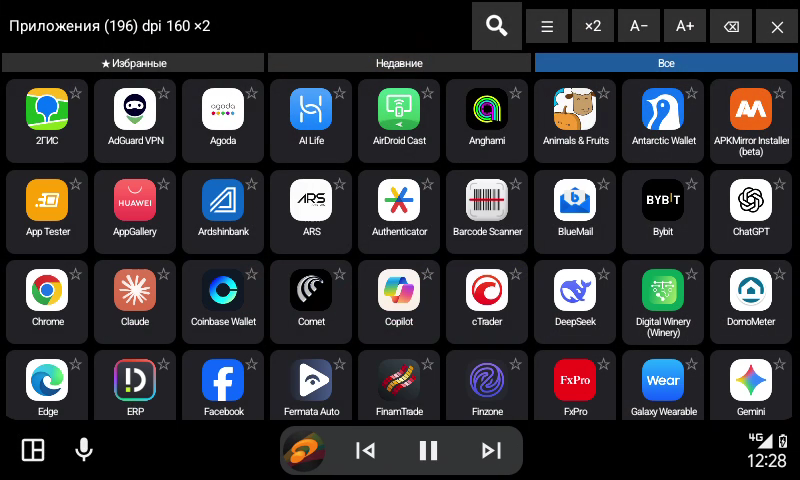
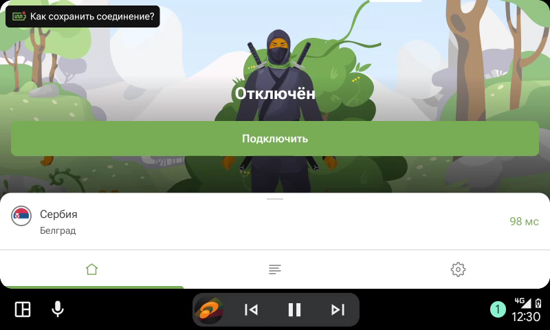

# AA Bridge

[English](README.md) · [Русский](README.ru.md) · [Пошаговая инструкция](https://flatisqa.github.io/aa-bridge/) · [Скачать](https://github.com/flatisqa/aa-bridge/releases/latest)

Приложение для Android, которое выводит на экран Android Auto приложения, которых там нет по умолчанию: плееры, браузеры, VPN-клиенты и другие.

<table>
  <tr>
    <td></td>
    <td></td>
    <td></td>
  </tr>
  <tr>
    <td align="center">Телефон</td>
    <td align="center">Машина: список</td>
    <td align="center">Машина: обёртка</td>
  </tr>
</table>

## Как это работает

AA Bridge виден в лаунчере Android Auto как обычное приложение. Выбранные приложения запускаются на виртуальном экране, картинка с которого идёт на экран машины, а нажатия с экрана машины передаются обратно.

Открыть приложение можно двумя способами:

- **Иконка AA Bridge.** Открывает список всех приложений телефона с поиском и вкладками «Избранные / Недавние / Все». Выбранное приложение открывается на весь экран.
- **Обёртка.** Маленький отдельный APK, который создаётся на телефоне для одного приложения и даёт ему свою иконку в лаунчере машины. Приложение открывается сразу.

## Требования

- Android 10 и новее (`minSdk 29`). Проверено только на одном телефоне: Android 16, HyperOS.
- Android Auto с включёнными «Неизвестными источниками» в настройках разработчика.
- Wi-Fi для разовой настройки (любая сеть).

## Установка

1. Скачайте APK из [Releases](https://github.com/flatisqa/aa-bridge/releases/latest) и откройте его.
2. Play Защита покажет предупреждение. Нажмите **«Подробнее»**, затем **«Установить без проверки»**. Кнопку **«Проверить»** не нажимайте (см. ниже).
3. Пройдите онбординг: включите «Неизвестные источники» в Android Auto, разрешите уведомления.
4. Один раз сопрягите приложение с «Беспроводной отладкой» самого телефона, введя код из уведомления.
5. По желанию включите «режим движения», чтобы приложение работало в машине без Wi-Fi.

Полная инструкция со скриншотом на каждом шаге: [пошаговая инструкция](https://flatisqa.github.io/aa-bridge/).

## Что важно знать

**Play Защита.** Приложение не из Google Play и просит нестандартные возможности (установка пакетов, беспроводная отладка, виртуальные экраны), поэтому Play Защита предупреждает при каждой установке и обновлении, в том числе при добавлении каждой новой обёртки. Всегда выбирайте «Установить без проверки». «Проверить» отправляет APK в Google, а отрицательный вердикт может заблокировать установку этого пакета, поэтому мы не советуем.

**Режим движения** действует, пока жив процесс приложения. Если смахнуть приложение из недавних или перезагрузить телефон, он выключится, и его нужно включить заново с Wi-Fi.

**Выход из приложения в машине.** Кнопок на экране нет. Быстро тапните три раза по верхнему краю экрана, откроется меню «Назад» и «Закрыть».

**Ограничения при движении.** AA Bridge не снимает ограничения Android Auto во время движения. Использовать его за рулём или нет, решаете вы сами, и в вашей стране это может быть запрещено.

Приложение не связано с Google. Исходный код не опубликован.

## Лицензия

[MIT](LICENSE)
